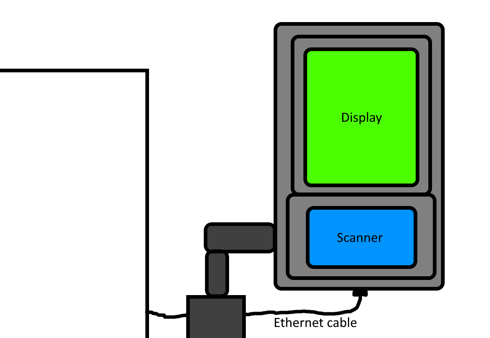
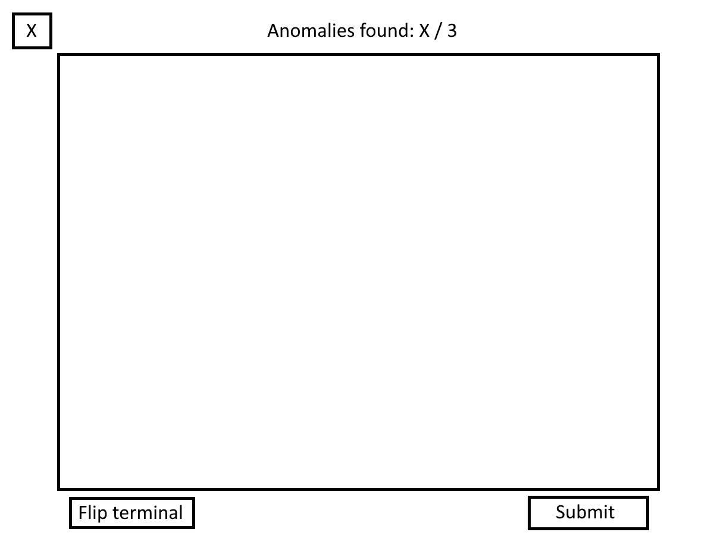
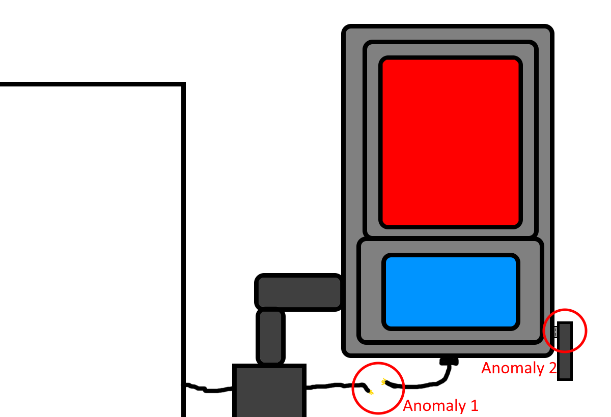
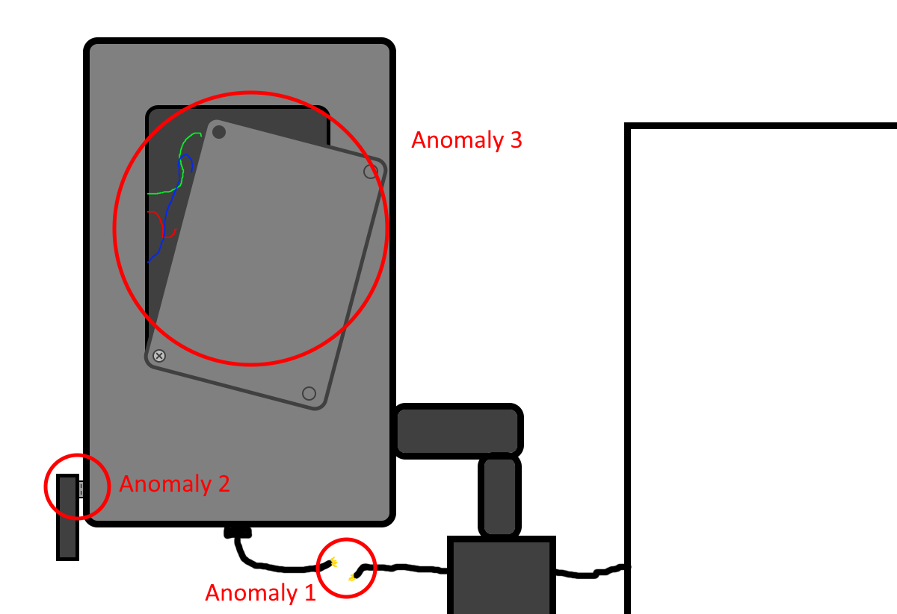

# Design Document: Use Case 1 – "Spot the Anomaly"

**Project:** Operational Technology (OT) Security Awareness for Entur Field Technicians  
**Module:** Use Case 1 (Physical Hardware Inspection)  
**Deliverable Type:** Conceptual Design & Interactive Figma Prototype  
**Target Audience:** Entur Field Technicians & Depot Maintenance Personnel  

---

## 1. Overview & Learning Objectives

### 1.1 Purpose
This module trains field technicians to perform mandatory physical inspections of onboard ticketing validator units and maintenance terminals before connecting diagnostic tools or initiating software updates.

### 1.2 Core Learning Objectives
* **Identify Hardware Tampering:** Recognize unauthorized physical additions (e.g., rogue USB keyloggers, hardware taps).
* **Detect Seal Breaches:** Identify missing, broken, or tampered physical security seals on device enclosures.
* **Spot Supply-Chain Anomalies:** Recognize modified, spliced, or non-standard cabling inserted into internal buses (e.g., vehicle ethernet / CAN bus links).

---

## 2. User Journey & Screen Architecture

```
[ Screen 1: Briefing ] ---> [ Screen 2: Interactive Inspection ] ---> [ Screen 3: Learning Summary ]
```

---

## 3. Detailed Screen Specifications

### Screen 1: Scenario Briefing & Context

* **Header Title:** `Module 1: Physical Hardware Inspection`
* **Context Banner:** `Location: Bus Depot`
* **Scenario Narrative:**  
  > You have been dispatched to perform routine maintenance on an onboard ticketing validator unit. Before connecting your diagnostic laptop or applying firmware updates, you must verify that the physical hardware has not been compromised or tampered with.
* **Instruction:** Identify all 3 physical anomalies on the hardware photo.
* **UI Controls:** Primary Button `[ Begin Physical Inspection ]`

Sketch:

---

### Screen 2: Interactive Inspection Interface

* **Layout:** Centered high-resolution visual of an Entur onboard ticketing validator unit with 3 hidden clickable hotspot areas.
* **UI Counter:** `Anomalies Found: X / 3`

UI Sketch:


Image sketches:



#### Hotspot Specifications & Feedback Data

| Hotspot ID | Element | Visual Location | Associated Security Risk | Triggered Feedback Text |
| :--- | :--- | :--- | :--- | :--- |
| **H-01** | **Rogue USB Dongle** | Bottom auxiliary service port | Data exfiltration, malicious firmware injection, keylogging. | 🟢 **Correct!** An unauthorized wireless USB dongle was detected. Rogue hardware can log data or inject unauthorized commands into the device. |
| **H-02** | **Compromised Security Seal** | Main housing screw (side) | Unauthorized physical opening of internal circuitry. | 🟢 **Correct!** The tamper-evident seal is torn/peeled back. This indicates unauthorized internal access to device electronics. |
| **H-03** | **Spliced Inline Cable** | Rear ethernet connector behind bracket | Man-in-the-Middle (MitM) hardware tap on internal vehicle bus. | 🟢 **Correct!** A non-standard inline connector was attached. Hardware taps allow attackers to intercept communications with vehicle gateways. |

* **Default / Missed Click Feedback:**
  * **Trigger:** Click on normal component (e.g., standard mounting bolt, touch screen glass).
  * **System Response:** Toast notification: 🔴 *Standard hardware component. Check ports, seals, and cable connections for anomalies.*

---

### Screen 3: Completion & Pedagogical Summary

* **Header Title:** `Inspection Complete: 3/3 Anomalies Identified`
* **Key Takeaway Cards:**
  1. **Visual First:** A 30-second visual inspection prevents critical network intrusion.
  2. **Verify Integrity:** Never connect personal/diagnostic laptops to units with broken tamper seals.
  3. **Report Immediately:** Document physical anomalies before attempting hardware reboots or maintenance.
* **UI Controls:**
  * Secondary Button: `[ Replay Module ]`
  * Primary Button: `[ Proceed to Use Case 2: Incident Response ]`

---

## 4. Design & Assets Requirements for Figma

* **Graphic Assets:** 
  * 1x Base graphic of transit ticketing validator (angled view showing ports & cables).
  * 3x Overlay sprites representing: USB dongle, broken tamper sticker, wire splitter.
* **Color Palette:**
  * **Base Theme:** Dark slate / Entur Blue accents (`#0059B3`).
  * **Feedback Colors:** Success Green (`#2E7D32`), Error Red (`#D32F2F`), Warning Amber (`#ED6C02`).
